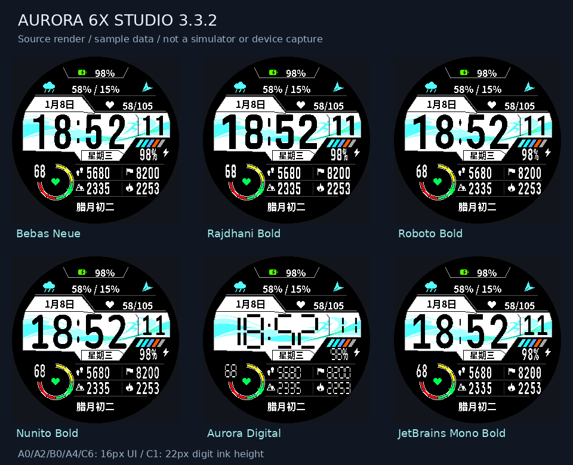

# Aurora 6X Studio

**A customizable digital watchface for Garmin fēnix 6X Pro / Pro Solar.** 280×280 MIP · Chinese and English · six digit typefaces · 32 central backgrounds.

[中文](README.md) · [Download v3.3.2](https://github.com/yilongzhao1122/aurora6x-studio/releases/tag/v3.3.2) · [Installation and settings](docs/User_Guide.en.md) · [Report an issue](https://github.com/yilongzhao1122/aurora6x-studio/issues)

*Rendered from source with sample data. These are not simulator or watch screenshots.*

## Current version

A0, A2, B0, A4 and C6 use a dedicated 16px UI font. C1 uses 22px digit ink height and follows the selected data typeface. Other positions retain their own fonts.

- Per-position on-watch settings with switchable Chinese and English menus.
- Independently selectable clock and data digits: Bebas Neue, Rajdhani Bold, Roboto Bold, Nunito Bold, Aurora Digital and JetBrains Mono Bold.
- Noto Sans CJK SC Bold for bilingual UI, with native 16/24px bitmap icons.
- 32 central backgrounds, including 20 sport and flowing-shape themes, plus a custom background color.
- Each of the four lower metric slots offers 28 choices. Calories show the device-provided daily total.
- Offline settings preview, A/B/C field map, full source, artwork masters, font licenses and generated resources.

## Downloads

| Download | Starting language | Contents |
| --- | --- | --- |
| [English source package](https://github.com/yilongzhao1122/aurora6x-studio/releases/download/v3.3.2/Aurora6X-Studio-v3.3.2-Source-EN.zip) | English | Complete project and bilingual documentation |
| [Chinese source package](https://github.com/yilongzhao1122/aurora6x-studio/releases/download/v3.3.2/Aurora6X-Studio-v3.3.2-Source-CN.zip) | Chinese | The same project and bilingual documentation |
| [SHA256SUMS.txt](https://github.com/yilongzhao1122/aurora6x-studio/releases/download/v3.3.2/SHA256SUMS.txt) | — | SHA-256 checksums for both ZIPs |

Both packages support both languages. Change language under **Time and appearance → Language**. Previously saved watch settings can override the package default.

**Source build packages; no precompiled PRG is included.** Normal builds use generated resources and do not require Python. Build with the official SDK, official `fenix6xpro` device package and your own developer key.

## Quick start

1. Install Java, VS Code and the Garmin Monkey C extension. Use SDK Manager to install Connect IQ SDK and the official `fenix6xpro` device package.
2. Extract the entire ZIP. Place your developer key file at `keys/developer_key`, or set `GARMIN_DEVELOPER_KEY`.
3. Run `00_Check_Environment.cmd`, then `01_Run_Simulator.cmd`.
4. Select **Simulation → Trigger App Settings** to choose fields, language, fonts and backgrounds.
5. Run `02_Build_For_Watch.cmd`, copy `bin/Aurora6X.prg` to `GARMIN/APPS`, safely disconnect and select the watchface.

Open `START_HERE.html` for both language entry points. `设置助手.html` provides offline sample previews and configuration export; its field labels are bilingual. See the [English user guide](docs/User_Guide.en.md) for the position map and controls.

## Validation

Local settings, data and actual bitmap-pixel checks have passed, including 636 typeface/hour-format/metric scenes. v3.3.2 has not completed SDK compilation, official device-package simulator execution or physical watch testing. Source previews cannot establish peak RAM, battery life or live-data agreement. See [validation notes](docs/Validation.en.md).

## Development and license

See [development notes](docs/Development.en.md), [data sources](docs/Data.en.md) and [font licenses](docs/FONT_LICENSES.txt). The packaging helper includes committed files only and creates both language ZIPs with SHA-256 checksums.

Code is [MIT licensed](LICENSE). Bundled fonts and other third-party components retain their respective licenses. Independent project; not affiliated with Garmin.
