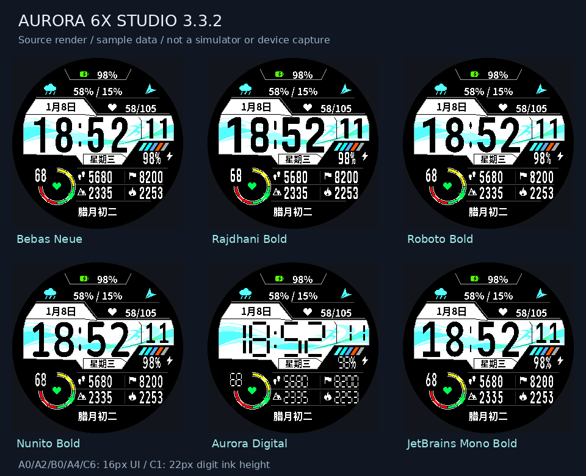

# Aurora 6X Studio

**Garmin fēnix 6X Pro / Pro Solar 可自定义数字表盘。** 280×280 MIP · 中英双语 · 六种数字字体 · 32 款中央背景。

[English](README.en.md) · [下载 v3.3.2](https://github.com/yilongzhao1122/aurora6x-studio/releases/tag/v3.3.2) · [安装与设置](docs/使用说明.md) · [反馈问题](https://github.com/yilongzhao1122/aurora6x-studio/issues)

*源码渲染，使用示例数据；不是 Garmin 模拟器或真机截图。*

## 当前版本

A0、A2、B0、A4、C6 使用独立的 16 号字体；C1 数字可见高度为 22 像素，并跟随所选数据数字字体。其他位置保留各自字体。

- 在手表上分别设置各栏位，中文与英文可随时切换。
- 时间和数据数字分别提供 Bebas Neue、Rajdhani Bold、Roboto Bold、Nunito Bold、Aurora Digital、JetBrains Mono Bold。
- 中文与英文 UI 使用 Noto Sans CJK SC Bold；图标为原生 16/24 像素资源。
- 32 款中央背景，包含 20 款运动与流线图案；支持自定义背景色。
- 下方四格各可选择 28 项指标；热量显示设备直接提供的当天总消耗。
- 离线设置助手、A/B/C 位置图、完整源码、原图、字体许可和预生成资源随包提供。

## 下载

| 下载 | 默认语言 | 内容 |
| --- | --- | --- |
| [中文源码构建包](https://github.com/yilongzhao1122/aurora6x-studio/releases/download/v3.3.2/Aurora6X-Studio-v3.3.2-Source-CN.zip) | 中文 | 完整工程与中英文文档 |
| [English source package](https://github.com/yilongzhao1122/aurora6x-studio/releases/download/v3.3.2/Aurora6X-Studio-v3.3.2-Source-EN.zip) | English | 同一工程与中英文文档 |
| [SHA256SUMS.txt](https://github.com/yilongzhao1122/aurora6x-studio/releases/download/v3.3.2/SHA256SUMS.txt) | — | 两个 ZIP 的 SHA-256 校验值 |

两个包的功能相同，默认语言不同；安装后可在“时间与外观 → 界面语言”切换。已有手表设置可能覆盖默认语言。

**这是源码构建包，不含预编译 PRG。** 常规编译不需要 Python。请使用官方 SDK、`fenix6xpro` 设备包及自己的开发密钥构建。

## 快速开始

1. 安装 Java、VS Code 与 Garmin Monkey C 扩展；通过 SDK Manager 安装 Connect IQ SDK 和官方 `fenix6xpro` 设备包。
2. 完整解压 ZIP，将开发密钥文件放在 `keys/developer_key`，或设置 `GARMIN_DEVELOPER_KEY`。
3. 运行 `00_Check_Environment.cmd`，通过后运行 `01_Run_Simulator.cmd`。
4. 在模拟器选择 **Simulation → Trigger App Settings**，调整栏目、语言、字体和主题。
5. 运行 `02_Build_For_Watch.cmd`，将 `bin/Aurora6X.prg` 复制到手表的 `GARMIN/APPS`，安全弹出后选择该表盘。

双击 `START_HERE.html` 查看中英文入口；`设置助手.html` 提供离线示例预览与配置导出。详细操作见[中文指南](docs/使用说明.md)和 [English guide](docs/User_Guide.en.md)。

## 验证范围

已运行本地设置、数据和真实位图像素检查，包括 636 组字体/时制/指标场景。v3.3.2 尚未完成 SDK 编译、官方设备包模拟器运行和真机验证。源码预览不能验证实际内存峰值、功耗或实时数据一致性，详见[验证说明](docs/验证说明.md)。

## 开发与许可

参见[开发说明](docs/开发说明.md)、[数据说明](docs/数据说明.md)和 [English development notes](docs/Development.en.md)。发布辅助程序仅打包已提交文件，提供中英文 ZIP 和 SHA-256。

代码采用 [MIT](LICENSE)。字体和第三方组件保留各自许可，见 [FONT_LICENSES.txt](docs/FONT_LICENSES.txt)。本项目独立开发，与 Garmin 无隶属关系。
